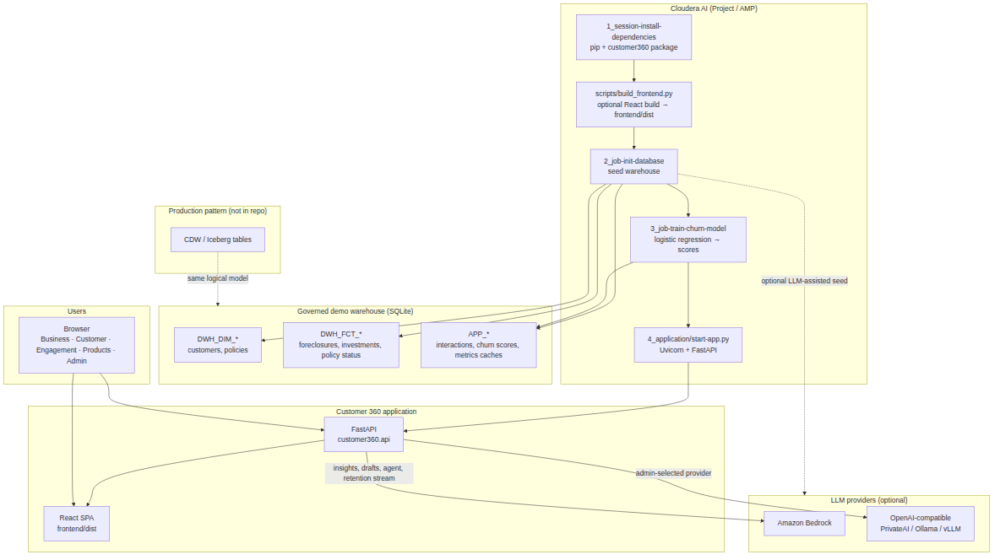
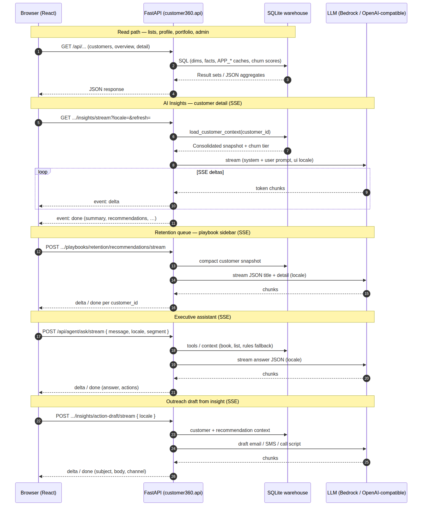

# Cloudera Blueprint: Insurance Customer 360

## Table of Contents

- [Overview](#overview)
- [Demo](#demo)
- [Use Case](#use-case)
- [Key Features](#key-features)
- [Quickstart / Guide](#quickstart--guide)
- [Architecture / Software Components](#architecture--software-components)
- [Target Audience](#target-audience)
- [Repository Structure](#repository-structure)
- [Prerequisites](#prerequisites)
- [Hardware Requirements](#hardware-requirements)
- [Documentation](#documentation)

## Overview

Insurance Customer 360 brings a policyholder's policies, investments, liens, and interaction
history into a single view. It scores each customer's churn risk with a machine learning model
and uses generative AI to explain that risk and draft the next retention action. The blueprint
runs as a launchable Applied ML Prototype (AMP) on **Cloudera AI**: one import provisions the
dependencies, builds a synthetic insurance warehouse, trains the churn model, and starts a web
dashboard. Data, model training, and the application all stay inside the governed Cloudera
platform. The LLM is pluggable: use Amazon Bedrock or a private OpenAI-compatible endpoint.

## Demo

Reprise walkthrough: _coming soon_

## Use Case

Insurers hold customer data across separate policy, investment, and service systems. Agents and
retention teams cannot see the whole relationship, so they often learn a customer is leaving
only after a surrender or lapse request.

This blueprint gives those teams one place to:

- see the full value of every relationship across life, health, property, pension, and savings
  products;
- prioritize the customers most likely to churn, ranked by risk and value at stake;
- act on that risk with personalised, AI-drafted outreach.

The business outcome is higher retention and assets under management, through earlier,
better-targeted intervention.

## Key Features

- **Unified customer view.** Policies, coverage, investment performance, liens, and interaction
  history (reviews, agent questions, searches) in one profile.
- **Churn risk scoring.** A logistic-regression model trained on warehouse behaviour and
  interaction signals assigns every customer a churn probability and risk tier.
- **AI customer insights.** Streaming, per-customer summaries explain why a customer is at risk
  and recommend the next best action.
- **Generated outreach.** One click drafts a personalised email, SMS, or call script for a
  recommended action.
- **Retention playbook.** A prioritized queue of at-risk customers with AI-generated
  recommendations.
- **Portfolio analytics.** Book-level KPIs, segment comparisons, and strategic objective trends
  (savings AUM, premium momentum, engagement) measured against configurable benchmarks.
- **Analytics copilot.** A tool-calling assistant that answers natural-language questions about
  customers, cohorts, products, and the portfolio.
- **Multi-region, multi-language.** Synthetic data for Israel, the UK, Spain, Saudi Arabia, and
  France. UI in English, French, Spanish, Hebrew, and Arabic (with right-to-left layout).
- **Pluggable LLM.** Amazon Bedrock or any OpenAI-compatible endpoint, switchable from the Admin
  page. The core dashboard and churn scores still work without an LLM.

## Quickstart / Guide

### Deploy on Cloudera AI

1. In Cloudera AI, create a **New Project** from this Git repository (branch `main`) and choose
   **Configure as Prototype**. Alternatively, launch **Insurance Customer 360** from your AMP
   catalog (see [`amp-catalog.yaml`](amp-catalog.yaml)).
2. Optional: to enable the generative AI features, set the Amazon Bedrock environment variables
   during import (`AWS_*`, `CUSTOMER360_BEDROCK_REGION`, `CUSTOMER360_BEDROCK_MODEL_ID`). You
   can also configure an OpenAI-compatible endpoint after launch from **Admin → Configuration →
   LLM provider**.
3. The import runs these stages automatically:

   | Stage | Script                                        | Purpose                                         |
   | ----- | --------------------------------------------- | ----------------------------------------------- |
   | 1     | `1_session-install-dependencies/install.py`   | Install Python dependencies and the `customer360` package |
   | 2     | `scripts/build_frontend.py`                   | Build the React UI (skipped when `frontend/dist` is present) |
   | 3     | `2_job-init-database/init_database.py`        | Seed the synthetic insurance warehouse          |
   | 4     | `3_job-train-churn-model/train_churn.py`      | Train the churn model and write scores          |
   | 5     | `4_application/start-app.py`                  | Start the **Customer 360 Dashboard** application |

4. Open **Customer 360 Dashboard** from the project's **Applications** tab.

Full deployment steps: [docs/CAI_APPLICATION.md](docs/CAI_APPLICATION.md).

### Run locally

```bash
git clone <this-repo> && cd <this-repo>
python3 -m pip install -r requirements.txt
python3 -m pip install -e .
python3 scripts/init_db.py                     # seed data/customer360.db
python3 3_job-train-churn-model/train_churn.py # churn scores
python3 4_application/start-app.py             # http://127.0.0.1:8080
```

Copy [`.env.example`](.env.example) to configure Bedrock locally. Run tests with
`python3 -m pytest`.

## Architecture / Software Components



| Component | Technology | Role |
| --- | --- | --- |
| Platform | Cloudera AI (AMP, Jobs, Applications) | Runs the setup jobs and hosts the web application |
| Warehouse | SQLite (`DIM_*`, `FCT_*`, `APP_*` tables) | Synthetic policy, investment, interaction, churn, and cache data |
| Churn model | scikit-learn (`StandardScaler` + balanced logistic regression) | Scores churn probability and risk tier per customer |
| Backend | Python 3.11, FastAPI, Uvicorn | REST API, plus server-sent event (SSE) streams for LLM output |
| Frontend | React 18, TypeScript, Vite, i18next | Single-page dashboard served by FastAPI from `frontend/dist` |
| Generative AI | Amazon Bedrock, or an OpenAI-compatible endpoint | Customer insights, outreach drafts, retention recommendations, copilot, and seed data generation |

The application runs as a single process on the Cloudera AI application port. FastAPI serves
both the `/api` endpoints and the prebuilt React UI. Reads are plain REST calls. Insights,
outreach drafts, the retention queue, and copilot answers stream to the browser as they are
generated:



The demo uses SQLite so it runs without external infrastructure. The Admin page can store and
test connection settings for Cloudera Data Warehouse (Impala/Trino) and Iceberg. These
connections are tested only; queries in this release still run against SQLite. In production,
the same logical model maps onto CDW or Iceberg tables.

Diagram sources: [docs/diagrams/](docs/diagrams/README.md).

## Target Audience

- **Solution architects and sales engineers** demonstrating Customer 360, churn, and generative
  AI use cases to insurance customers.
- **Data scientists and ML engineers** extending the churn model or the LLM prompts and tools.
- **Application developers** adapting the FastAPI + React application pattern to Cloudera AI.
- **Insurance business stakeholders** (retention, distribution, customer experience) evaluating
  AI-assisted retention workflows.

## Repository Structure

| Path | Description |
| --- | --- |
| `.project-metadata.yaml` | AMP definition: environment variables, setup jobs, and the application |
| `amp-catalog.yaml` | AMP catalog entry for Site Administration → AMPs |
| `METADATA.yaml` | Catalog metadata for the Cloudera blueprint website |
| `1_session-install-dependencies/` | Stage 1: Python dependency install |
| `2_job-init-database/` | Stage 3: warehouse seed job |
| `3_job-train-churn-model/` | Stage 4: churn model training job |
| `4_application/` | Stage 5: application launcher |
| `customer360/` | Python package: seed, warehouse, churn, insights, copilot agent, LLM providers, API |
| `frontend/` | React + TypeScript UI (source in `src/`, prebuilt bundle in `dist/`) |
| `data/` | Warehouse DDL (`*_schema.sql`) and cached LLM seed material (`seed_cache/`) |
| `scripts/` | Frontend build, local seed, scaling, and cache refresh utilities |
| `docs/` | Deployment guide, operations guide, and architecture diagrams |
| `tests/` | pytest unit and API integration tests |
| `app/`, `static/` | Separate sentiment-analysis reference demo (not part of this blueprint) |

## Prerequisites

- **Cloudera AI** workspace with permission to create projects, jobs, and applications, and a
  **Python 3.11 Workbench (Standard)** runtime.
- **Git access** to this repository from the Cloudera AI workspace.
- **Optional: an LLM provider** for the generative AI features:
  - an AWS account with **Amazon Bedrock** access to a model (default
    `anthropic.claude-haiku-4-5-20251001-v1:0`), with credentials or an instance profile; or
  - an **OpenAI-compatible endpoint** (for example Cloudera AI Inference, vLLM, or Ollama) and
    its API token.
- **Outbound network**: AWS Bedrock endpoints for your region (if using Bedrock). `nodejs.org`
  is needed only if you rebuild the UI without Node installed.
- **Local development**: Python 3.11+. Node.js 18+ only if you change the UI.

## Hardware Requirements

No GPU is required; LLM inference runs on the external provider.

| Deployment | Minimum |
| --- | --- |
| Launchable / demo (AMP) | Application: 2 vCPU, 4 GiB RAM. Setup jobs: up to 2 vCPU, 4 GiB RAM each (from `.project-metadata.yaml`) |
| Production / enterprise | _To be determined._ Size against the customer's warehouse (CDW / Iceberg) and LLM endpoint |

## Documentation

- [Deploy on Cloudera AI](docs/CAI_APPLICATION.md): AMP import, catalog registration, runtime,
  and manual reruns
- [Operations guide](docs/OPERATIONS.md): environment variables, LLM providers, localization and
  reseeding, scaling, caches, frontend builds, and Workbench tips
- [Architecture diagrams](docs/diagrams/README.md): Mermaid sources and regeneration commands
- [Cloudera AI documentation](https://docs.cloudera.com/machine-learning/cloud/index.html)
- [Amazon Bedrock documentation](https://docs.aws.amazon.com/bedrock/)
